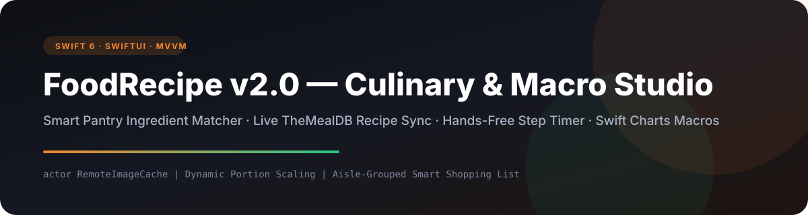
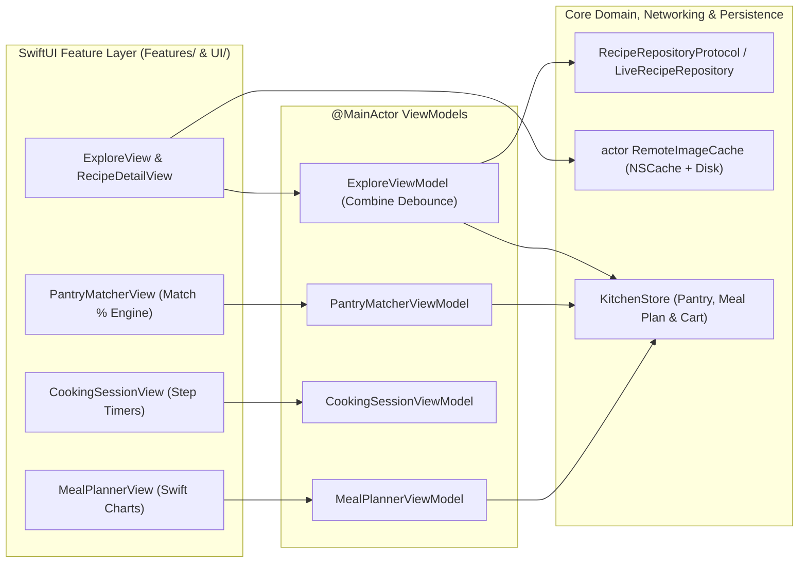

<div align="center">
  
</div>

<p align="center">
  
  
  
  
</p>

**FoodRecipe v2.0** is a native iOS culinary discovery, smart pantry ingredient matcher, hands-free cooking timer, and macro meal planner built with **Swift 6**, **SwiftUI**, **Combine**, **Swift Charts**, and **Protocol-Oriented MVVM**.

---

## Key Engineering Highlights

- **Smart Pantry Ingredient Matcher (`PantryMatcherViewModel`)**: Scores and ranks recipes in real time by **Pantry Match %** based on the ingredients currently available in the user's kitchen, isolating missing items for 1-tap export to the shopping cart.
- **Hybrid Live + Offline Recipe Engine (`LiveRecipeRepository`)**: Fetches live dishes and high-resolution meal photography asynchronously from [`TheMealDB` Open API](https://www.themealdb.com/api.php) while bundling an offline-first curated chef catalog (Anatolian, Mediterranean, High-Protein, Italian, and Asian bowls).
- **Actor-Isolated Image Caching (`actor RemoteImageCache`)**: Two-tier (`NSCache` memory + disk directory) image pipeline with **in-flight task coalescing** to prevent duplicate network requests while scrolling.
- **Dynamic Portion & Macro Scaling (`Recipe.scaledIngredients(forServings:)`)**: Pure functional scaling engine that recalculates gram/unit measurements and calorie/protein/carb/fat totals dynamically from `1` to `12` servings.
- **Hands-Free Step-by-Step Cooking Mode (`CookingSessionView`)**: High-contrast full-screen kitchen assistant with per-step countdown timers, progress tracking, and chef tips.
- **Weekly Macro Analytics & Aisle-Grouped Shopping List (`MealPlannerView`)**: Native **Swift Charts** visualization comparing scheduled daily calories and protein against user targets, paired with an automated grocery list organized by supermarket aisle.

---

## System Architecture



---

## Directory Structure

```text
FoodRecipe/
├── App/
│   ├── FoodRecipeApp.swift            # App entry point & DI root
│   └── MainTabView.swift              # 4-tab dark-mode navigation shell
├── Core/
│   ├── DI/
│   │   └── AppContainer.swift         # Protocol-oriented dependency container
│   ├── Models/
│   │   └── RecipeModels.swift         # Recipe, MacroBreakdown, PantryMatchResult, CookingStep
│   ├── Networking/
│   │   ├── RecipeRepository.swift     # TheMealDB async client + offline chef catalog
│   │   └── RemoteImageCache.swift     # Actor-isolated memory + disk image cache
│   └── Persistence/
│       └── KitchenStore.swift         # Favorites, Pantry inventory, Weekly Meal Plan & Cart
├── Features/
│   ├── CookingMode/                   # Hands-free step timer assistant
│   ├── Explore/                       # Recipe search, cuisine filters & dynamic portion scaler
│   ├── Favorites/                     # Saved personal cookbook
│   ├── MealPlanner/                   # Swift Charts weekly calorie/macro telemetry & aisle cart
│   └── PantryMatcher/                 # "What's in My Kitchen?" % match ranking engine
├── UI/
│   ├── Components/
│   │   ├── CachedMealImageView.swift  # Async cached dish photography view
│   │   └── MacroRingBadge.swift       # Circular protein/carb/fat telemetry ring
│   └── Theme/
│       └── CulinaryTheme.swift        # Saffron & Emerald dark-mode design tokens
└── FoodRecipeTests/
    └── FoodRecipeTests.swift          # XCTest suite for portion scaling, pantry matching & macros
```

---

## Verification & Typecheck

```bash
swiftc -typecheck \
  -sdk $(xcrun --sdk iphonesimulator --show-sdk-path) \
  -target arm64-apple-ios17.0-simulator \
  $(find FoodRecipe -name '*.swift') FoodRecipeTests/FoodRecipeTests.swift
```
